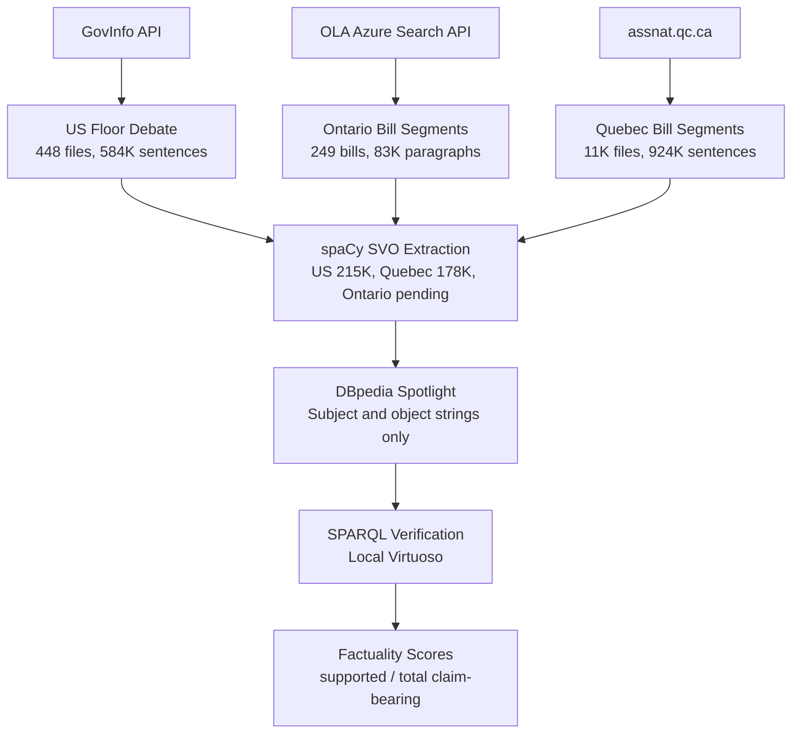

# Legislative Health Factuality

Does the factual accuracy of legislative health floor debate predict bill passage outcomes? This project scores factuality of health bill debates in the US House of Representatives, Ontario Legislative Assembly, and Quebec National Assembly from 1985 to 2026.

**Investigators:** Caprice Culkin (Yale School of Public Health) with David Chartash and Joanie Bouchard.

---

## Pipeline

---

## Documentation

[Interactive pipeline diagram](https://capriceculkin.github.io/legislative-he[Interactive pipeline diagram](https://capriceculkin.github.io/legislative-he[Interactive pipeline diagram](https://capriceculkin.github.io/legislative-he[Interactive pipeline diagram](https://capriceculkin.github.io/legislative-he[Interactive pipeline diagrwhat produces it, what it feeds into.

[Ontario verified bill segments on Yale OneDrive](https://yaleedu-my.sharepoint.com/:u:/g/personal/caprice_culkin_yale_edu/IQCAGMCyyH_0ToGTWu1erpwpAV8Bcot0NVoBJZ5BJPxiTYI?e=NO1Els) -- 116MB, Yale login required.

---

## Current Results

V2 pipeline scores pending. V1 reference with new bill-specific denominator:

US: mean factuality 0.2054. Passed 0.2094 (n=386), failed 0.2015 (n=34).

Quebec: mean factuality 0.1387. Passed 0.1266 (n=767).

Ontario: pipeline running.

Logistic regression on US and Quebec combined: factuality coefficient +0.0467 (p less than 0.05).

COVID natural experiment: US decreased 0.036 post-March 2020. Quebec decreased 0.053.
