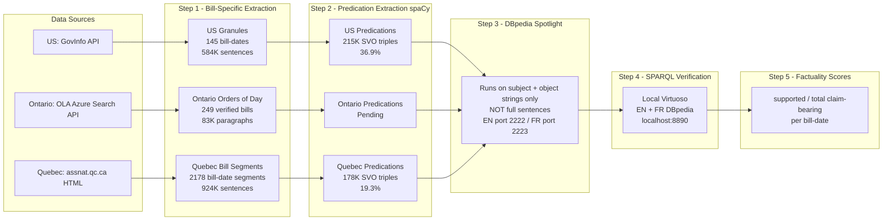

# Legislative Health Factuality

**Research question:** Does the factual accuracy of legislative health floor debate predict bill passage outcomes?

**Jurisdictions:** US House of Representatives, Ontario Legislative Assembly, Quebec National Assembly — 1985 to 2026

**Investigators:** Caprice Culkin (Yale School of Public Health) | David Chartash, Joanie Bouchard (advisors)

---

## Pipeline Overview



---

## Step 1: Bill-Specific Text Extraction

All three jurisdictions extract **floor/plenary debate text specific to each health bill only.**
Question period, petitions, member statements, committee transcripts, and all other business
on sitting days are excluded. This matches the US standard where GovInfo granules are
bill-specific by construction.

### United States — GovInfo Congressional Record Granules

**Source:** GovInfo API — `api.govinfo.gov/packages/`
**Collection script:** [`scripts/congressional_record_pull.py`](https://github.com/capriceculkin/legislative-health-factuality/blob/main/scripts/congressional_record_pull.py)
**Output:** `data/us/congressional_record_speeches/` — one `.txt` file per bill-date

Each GovInfo granule corresponds to one bill's floor debate. Bill-specific by construction —
no extraction needed. Health bills identified via CRS policy area tags.

**N = 145 health bill-dates | 584,111 sentences**

**Example:** [`data/us/congressional_record_speeches/2006-12-09-test.txt`](https://github.com/capriceculkin/legislative-health-factuality/blob/main/data/us/congressional_record_speeches/2006-12-09-test.txt)

```
ous adverse event report no later than 15
business days after the report is received
S. 3546
through the address or phone number de-
Be it enacted by the Senate and House of Rep-
scribed in section 502(x).
resentatives of the United States of America in
‘‘(2) N .—The re-
Congress assembled,
sponsible person shall submit to the Sec-
retary any new medical information, related
This Act may be cited as the ‘‘Dietary Sup-
to a submitted serious adverse event report
plement and Nonprescription Drug Consumer
that is received by the responsible person
```

### Ontario — OLA Azure Search API

**Source:** OLA Hansard Search backend — `aihansardsearch-apim.azure-api.net/api/search/keyword`
**Collection script:** [`scripts/fetch_ontario_hansard_via_api.py`](https://github.com/capriceculkin/legislative-health-factuality/blob/main/scripts/fetch_ontario_hansard_via_api.py)
**Cleaning script:** [`scripts/rebuild_clean_ontario.py`](https://github.com/capriceculkin/legislative-health-factuality/blob/main/scripts/rebuild_clean_ontario.py)
**Output:** `data/canada/ontario/hansard_api_bill_segments_clean.json`

The OLA Hansard search tool uses an Azure Cognitive Search backend.
I reverse-engineered the API endpoint from browser network traffic and built
a scraper that queries each bill's debate dates with:

```
filter: (date ge {date}T00:00:00Z and date le {date}T23:59:59Z)
        and (typeOfBusiness eq 'ORDERS OF THE DAY'
             or typeOfBusiness eq 'Orders of the Day')
```

**Bill assignment:** paragraphs are assigned to a specific bill only when the bill number
is explicitly mentioned in the paragraph text (e.g. 'Bill 94'). No topic fallback,
no single-bill date fallback. Every paragraph in the output has been verified.

**What is excluded:**
- Question Period / Oral Questions
- Members' Statements
- Petitions
- Introduction of Bills (first reading)
- Committee study transcripts
- Paragraphs that do not mention the specific bill number

**N = 249 verified bills | 83,443 paragraphs**

**Example:** Bill 124 — An Act to amend the Occupational Health and Safety Act
Debate date: 1985-11-26 | 204 paragraphs

```
I want to speak briefly on the bill. I do so both for reasons of principle and for personal reasons. I have never voted for back-to-work legislation in this assembly, whether it affected teachers or elevator workers or transit workers, because I believe if we have established in legislation the right to full and free collective bargaining, we abrogate that principle at very grave risk.  The risks 

I want to thank the several speakers who have addressed their minds and thoughts to the legislation now before the House. I would make some summary remarks in dealing with the presentations that have been made this afternoon, some of which have been truly exceptional, almost breathtaking, in the light of recent history.  Before I do that, I want to pay a particular tribute to my friend and colleag

```

### Quebec — Journal des débats Section Markers

**Source:** Assemblée nationale du Québec — `assnat.qc.ca`
**Collection script:** [`scripts/extract_quebec_bill_segments.py`](https://github.com/capriceculkin/legislative-health-factuality/blob/main/scripts/extract_quebec_bill_segments.py)
**Raw transcripts:** `data/canada/quebec_assembly/transcripts/` — one `.txt` file per sitting day
**Output:** `data/canada/quebec_assembly/bill_segments/` — one `.txt` file per bill-date

The Journal des débats uses structured section headers to mark when the Assembly
takes up a specific bill. The extraction script identifies these headers and
extracts only the text between the marker and the next section break.

**Section markers used:**
```
Étude du projet de loi n° X
Adoption du principe du projet de loi n° X
Reprise du débat sur l'adoption du principe du projet de loi n° X
Prise en considération du rapport sur le projet de loi n° X
Adoption du projet de loi n° X
```

**What is excluded:**
- Question period (période des questions)
- Ministerial statements (déclarations ministérielles)
- Petitions
- Introduction of bills (dépôt de projets de loi)
- Commission parlementaire transcripts (separate corpus — same as US excludes committee hearings)
- All other business on sitting days not related to the specific bill

**N = 8,365 bill-date segments | 923,634 sentences**

**Example:** Bill 152 — date 2000-11-22
[`data/canada/quebec_assembly/bill_segments/20001122_bill152.txt`](https://github.com/capriceculkin/legislative-health-factuality/blob/main/data/canada/quebec_assembly/bill_segments/20001122_bill152.txt)

**Raw sitting day (before extraction) — 1995-12-04:**
```
DÉCLARATIONS DE DÉPUTÉS
  Mme Carrier-Perreault: Je veux souligner le travail remarquable...

QUESTIONS ET RÉPONSES ORALES
  M. Johnson: M. le Président, ma question s'adresse au premier ministre...

ÉTUDE DU PROJET DE LOI N° 130  ← section marker
  M. Rochon: M. le Président, l'Assemblée nationale prend maintenant en
  considération le projet de loi 130 sur les services de santé...

PÉTITIONS  ← excluded
  M. Beaudet: Je dépose la pétition suivante...
```

**After extraction — bill-specific segment only:**
```
Étude détaillée du projet de loi n° 152
M. Lachance:
 Merci, M. le Président. Il me fait plaisir de déposer le rapport de la commission des transports et de l'environnement qui a siégé le 21 novembre 2000 afin de procéder à l'étude détaillée du projet de loi n° 152, Loi modifiant la Loi sur la conservation et la mise en valeur de la faune et la Loi sur les droits de chasse et de pêche dans les territoires de la Baie James et du Nouveau-Québec. La commission a adopté le projet de loi avec des amendements.
Le Président:
 Alors, bien. Ce rapport de commission est déposé.
Dépôt de pétitions
	Maint
```

---

## Step 2: Predication Extraction (spaCy)

**Script:** [`scripts/extract_predications.py`](https://github.com/capriceculkin/legislative-health-factuality/blob/main/scripts/extract_predications.py)
**Input:** `sentences.json` for each jurisdiction
**Output:** `predications.json` — Subject-Verb-Object triples

Per David Chartash's September 11 2026 revision: spaCy's dependency parser extracts
Subject-Verb-Object predications from each sentence BEFORE running DBpedia Spotlight.
Spotlight then runs only on the subject and object strings, not the full sentence.

**Why this matters:**

```
Old approach (v1):
  Sentence: 'The OMA, which represents 30,000 physicians, endorsed this legislation.'
  Spotlight on full sentence → entities: OMA, Physician, Legislation
  Pairs: (OMA, Physician) ← confirmed by DBpedia, but NOT the claim being made
         (OMA, Legislation) ← not in DBpedia
         (Physician, Legislation) ← not in DBpedia
  Problem: (OMA, Physician) is spuriously confirmed — it was in a relative clause

New approach (v2):
  spaCy extracts: subject='OMA', verb='endorsed', object='legislation'
  Spotlight runs on 'OMA' and 'legislation' only
  Pair: (OMA, Legislation) → not in DBpedia → correctly unsupported
  The relative clause entity 'physicians' is never included
```

**What is excluded at this step:**
- Sentences where the root verb is existential (be/have/do) — not factual claims
- Sentences where no subject or no object is found
- Entities found only in relative clauses or parentheticals
- Subject equals object (trivial self-reference)

Hedged predicates (may/might/could/should/pourrait/devrait) are included but flagged.

**N counts:**

| Jurisdiction | Input sentences | Predications | Rate |
|---|---|---|---|
| US | 584,111 | 215,412 | 36.9% |
| Quebec | 923,634 | 177,952 | 19.3% |
| Ontario | (pipeline running) | (pending) | — |

Note: Quebec's lower rate (19.3% vs 36.9%) reflects fr_core_news_lg's lower recall
for Quebec legislative French compared to en_core_web_lg for English.

**Sample US predications:**
```
Sentence: "--- GPO-CRECB-1985-pt12-2-2 --The House met at o'clock noon."
  subject: "GPO-CRECB-1985-pt12"
  verb:    meet
  object:  "o'clock noon"

Sentence: "May Your spirit give courage and strength to them and to their families."
  subject: "Your spirit"
  verb:    give
  object:  "courage"
  [hedged]

Sentence: "Our hearts reach out in the bond of concern to those who are anx ious, even as we pray for understan"
  subject: "Our hearts"
  verb:    reach
  object:  "the bond"

Sentence: "The Chair has ex amined the Journal of the last day's proceedings and announces to the House his app"
  subject: "The Chair"
  verb:    amine
  object:  "the Journal"

```

**Sample Quebec predications:**
```
Sentence: "M. le Président, l'honorable
		lieutenant-gouverneur a pris connaissance de ce projet de loi et il e"
  sujet:  "gouverneur"
  verbe:  prendre
  objet:  "connaissance"

Sentence: "Le discours sur le budget prononcé le 23 avril 1985 a introduit,
		à compter de cette date, de nouve"
  sujet:  "Le discours"
  verbe:  introduire
  objet:  "de nouvelles mesures"

Sentence: "Des régions comme celle que je
		représente en savent quelque chose."
  sujet:  "Des régions"
  verbe:  savoir
  objet:  "quelque chose"

Sentence: "Le
		secrétaire général n'a pas reçu d'avis concernant
		le dépôt de pétitions."
  sujet:  "Le
		secrétaire général"
  verbe:  recevoir
  objet:  "d'avis"

```

---

## Step 3: DBpedia Spotlight Entity Linking

**Script:** [`scripts/dbpedia_batch_pipeline.py`](https://github.com/capriceculkin/legislative-health-factuality/blob/main/scripts/dbpedia_batch_pipeline.py) — `extract_v2` stage
**Infrastructure:** Dunkleosteus server (Yale) — English port 2222, French port 2223
**SSH tunnel:** `ssh -i ~/.ssh/dunkleosteus_key -L 2222:localhost:2222 -L 2223:localhost:2223 cc3436@10.168.171.152`

Spotlight runs on the **subject string** and **object string** from each predication,
not on the full sentence. Returns DBpedia URIs for each entity found.

```
Input predication:
  subject: 'Ontario Medical Association'
  object:  'legislation'

Spotlight on 'Ontario Medical Association' →
  dbpedia.org/resource/Ontario_Medical_Association

Spotlight on 'legislation' →
  dbpedia.org/resource/Legislation

Entity pair: (Ontario_Medical_Association, Legislation)
```

**What is excluded:**
- Predications where Spotlight finds no entity for subject or object
- Predications where subject and object link to the same entity

---

## Step 4: SPARQL Verification

**Script:** [`scripts/dbpedia_batch_pipeline.py`](https://github.com/capriceculkin/legislative-health-factuality/blob/main/scripts/dbpedia_batch_pipeline.py) — `query` stage
**Endpoint:** Local Virtuoso instance on Dunkleosteus — `http://localhost:8890/sparql`
Both English DBpedia and French DBpedia loaded in same Virtuoso container.

For each unique entity pair, a SPARQL query checks whether DBpedia confirms
a direct relationship between the two entities.

```sparql
SELECT ?a ?b ?p WHERE {
  VALUES (?a ?b) { (<URI_A> <URI_B>) }
  { ?a ?p ?b } UNION { ?b ?p ?a }
}
```

**Supported example:**
```
Pair: (dbpedia:Canada, dbpedia:United_States)
Result: dbo:neighboringMunicipality → supported = True
```

**Not supported example:**
```
Pair: (dbpedia:Ontario_Medical_Association, dbpedia:Legislation)
Result: [] → supported = False
```

The OMA endorsing legislation is a rhetorical claim — not a fact DBpedia can verify.
The relationship does not exist in the DBpedia knowledge graph.

---

## Step 5: Factuality Scores

**Script:** [`scripts/compute_factuality_scores.py`](https://github.com/capriceculkin/legislative-health-factuality/blob/main/scripts/compute_factuality_scores.py)

```
factuality_score = supported_sentences / total_claim_bearing_sentences
```

Where claim-bearing sentences are those where Spotlight found entities for
both subject and object of the extracted predication.

---

## Large Data Files

Files exceeding GitHub's 100MB limit are excluded from version control.
Regenerate using the scripts listed above.

| File | Size | Description | Script to regenerate |
|---|---|---|---|
| `data/canada/ontario/hansard_api_bill_segments_clean.json` | ~100MB | Ontario verified bill segments | `fetch_ontario_hansard_via_api.py` + `rebuild_clean_ontario.py` |
| `data/canada/ontario/sentences_bill_specific_api.json` | 669MB | Ontario bill-specific sentences | `convert_ontario_api_segments_to_sentences.py` |
| `data/dbpedia_pipeline/ontario/sentences.json` | 669MB | Ontario pipeline copy | copy from above |
| `data/dbpedia_pipeline/quebec/sentences.json` | ~200MB | Quebec bill-specific sentences | `convert_quebec_segments_to_sentences.py` |
| `data/dbpedia_pipeline/us/predications.json` | 86.8MB | US SVO predications | `extract_predications.py` |
| `data/dbpedia_pipeline/quebec/predications.json` | 80.2MB | Quebec SVO predications | `extract_predications.py` |

---

## Current Results (v1 pipeline, new bill-specific denominator)

Ontario v2 scores pending pipeline completion.

| Jurisdiction | Mean factuality | Passed bills | Failed bills |
|---|---|---|---|
| US | 0.2054 | 0.2094 (n=386) | 0.2015 (n=34) |
| Quebec | 0.1387 | 0.1266 (n=767) | n/a |
| Ontario | (pipeline running) | — | — |

**COVID natural experiment (pre/post March 2020):**
- US: −0.036 post-COVID
- Quebec: −0.053 post-COVID

**Logistic regression (US + Quebec):** factuality coefficient +0.0467 (p < 0.05)
