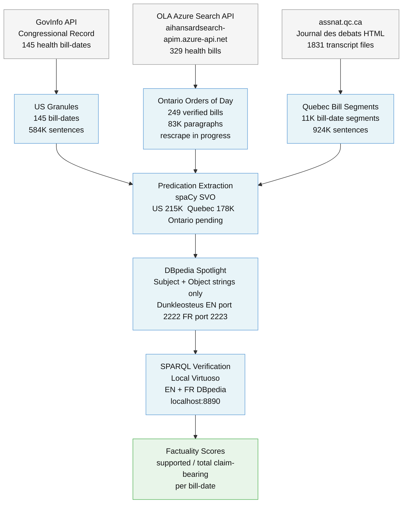

# Legislative Health Factuality

**Research question:** Does the factual accuracy of legislative health floor debate predict bill passage outcomes?

**Jurisdictions covered:** US House of Representatives, Ontario Legislative Assembly, Quebec National Assembly, spanning 1985 to 2026.

**Investigators:** Caprice Culkin (Yale School of Public Health) with David Chartash and Joanie Bouchard.

**Repository:** github.com/capriceculkin/legislative-health-factuality

---

## Pipeline

The pipeline has five stages. Each stage is documented below with the exact files it reads,
the files it produces, what gets removed at that stage, and real examples showing the
input and output text.



---

## Stage 1: Bill-Specific Text Extraction

The denominator for factuality scoring is the set of sentences spoken during
floor debate on a specific health bill. All three jurisdictions extract only
this bill-specific floor debate text, excluding question period, petitions,
member statements, ministerial statements, committee study transcripts, and
all other business on sitting days.

This matches the structure of the US data where GovInfo granules are
bill-specific by construction. Quebec uses section markers in the Journal
des debats. Ontario uses the OLA Azure Search API filtered to Orders of the Day.

### United States

Source: GovInfo API at `api.govinfo.gov/packages/`
Collection script: [https://github.com/capriceculkin/legislative-health-factuality/blob/main/scripts/congressional_record_pull.py](scripts/congressional_record_pull.py)
Output directory: `data/us/congressional_record_speeches/`

Each GovInfo granule corresponds to one bill's Congressional Record floor debate.
The granule ID encodes the bill and date. Health bills are identified via
CRS policy area tags in the package metadata.

After collection: 145 health bill-dates, 584,111 sentences.

Full example file: [https://github.com/capriceculkin/legislative-health-factuality/blob/main/data/us/congressional_record_speeches/2006-12-09-test.txt](data/us/congressional_record_speeches/2006-12-09-test.txt)

Excerpt from `2006-12-09-test.txt`:

```
ous adverse event report no later than 15
business days after the report is received
S. 3546
through the address or phone number de-
Be it enacted by the Senate and House of Rep-
scribed in section 502(x).
resentatives of the United States of America in
‘‘(2) N .—The re-
Congress assembled,
sponsible person shall submit to the Sec-
retary any new medical information, related
This Act may be cited as the ‘‘Dietary Sup-
```

### Ontario

Source: OLA Hansard search tool backend at `aihansardsearch-apim.azure-api.net`
Collection script: [https://github.com/capriceculkin/legislative-health-factuality/blob/main/scripts/fetch_ontario_hansard_via_api.py](scripts/fetch_ontario_hansard_via_api.py)
Cleaning script: [https://github.com/capriceculkin/legislative-health-factuality/blob/main/scripts/rebuild_clean_ontario.py](scripts/rebuild_clean_ontario.py)
Output: `data/canada/ontario/hansard_api_bill_segments_clean.json` ([Yale OneDrive](https://yaleedu-my.sharepoint.com/:u:/g/personal/caprice_culkin_yale_edu/IQCAGMCyyH_0ToGTWu1erpwpAV8Bcot0NVoBJZ5BJPxiTYI?e=NO1Els))

The OLA Hansard search tool uses an Azure Cognitive Search backend.
The API endpoint was identified by inspecting browser network traffic on the OLA search page.
The scraper queries each bill's debate dates using an OData filter:

```
POST aihansardsearch-apim.azure-api.net/api/search/keyword
filter: (date ge 1986-01-14T00:00:00Z and date le 1986-01-14T23:59:59Z)
        and typeOfBusiness eq 'ORDERS OF THE DAY'
rows: 500
```

Two capitalizations are required: pre-2018 Hansard uses 'ORDERS OF THE DAY'
in all caps, post-2018 uses 'Orders of the Day' in mixed case. Both are queried.

Bill assignment uses only one criterion: the bill number must appear explicitly
in the paragraph text. For example, a paragraph is assigned to Bill 94 only if
it contains the string 'Bill 94'. No topic fallback and no single-bill date
fallback are used. This ensures every paragraph in the output is verified.

The previous version of the scraper used a single-bill date fallback that
caused wrong assignments. For example, Bill 89 was assigned paragraphs
that opened with 'Resuming the adjourned debate on the motion for second
reading of Bill 68, An Act to amend certain Acts respecting Insurance.'
The current clean corpus removes all such cases.

What is excluded:
- Question Period and Oral Questions
- Members' Statements
- Petitions
- Introduction of Bills (first reading only)
- Committee study transcripts
- Paragraphs that do not mention the specific bill number in the text

After collection and verification: 249 bills, 83,443 paragraphs.
Rescrape with topic field storage is currently running and will increase coverage.

Full example: Bill 94, An Act regulating the Amounts that Persons may charge for Insured Services (extra billing)
Debate date: 1986-01-14. OLA Hansard page for this date:
https://www.ola.org/en/legislative-business/house-documents/parliament-34/session-1/1986-01-14/hansard

The paragraph text confirms assignment (Bill 94 mentioned):

```
The member for Brampton who had so much to say last time and kept the discussion going for so long.  I am glad the Minister of Health (Mr. Elston) indicated that I was wont to discuss things for an extended period of time. I spoke on one occasion on the pharmacy bills for a period of two and a half hours to put the concerns of some of the professio

I know the ideology of the member for Bellwoods is complete state control, but we still have a system in this province that requires caring professionals, individuals with a commitment to quality of care. That, also, has to be put into the mix. That is something the members of the third party will never understand, honour or commit themselves to ev

In that respect, he agrees with them. This is not a partisan issue involving Progressive Conservatives. We are talking about a group of caring individuals who have a closer relationship to this government than to me.

```

Full example: Bill 52, An Act to amend the Health Protection and Promotion Act
Debate date: 1987-06-25. OLA Hansard page:
https://www.ola.org/en/legislative-business/house-documents/parliament-34/session-1/1987-06-25/hansard

```
Briefly, with respect to the first question, I do not know the conflicting advice the member has received. I think the advice could be in the form of a patient speaking directly to someone or there could be pamphlet material as well. He is holding it up there. I presume the conflicting advice is that there could be various kinds of advice offered, 

The fact is that the member is saying we are going to give people information, and I totally agree that people should be given information about possible adverse effects of vaccinations; but at the same time he is saying that if this information is not provided, something is going to happen if parents are not aware of the possible risks. What if th

l appreciate the response from the Minister of Health regarding this 11th-hour amendment, given that members of this House have not had an opportunity to examine it; however, I have for the last 24 hours, and I am distressed by the lack of consultation that it appears went into this amendment.  Certainly, there has been no consultation with the Ass

```

### Quebec

Source: Assemblee nationale du Quebec at `assnat.qc.ca`
Raw transcripts: `data/canada/quebec_assembly/transcripts/` — one .txt file per sitting day
Extraction script: [https://github.com/capriceculkin/legislative-health-factuality/blob/main/scripts/extract_quebec_bill_segments.py](scripts/extract_quebec_bill_segments.py)
Output: `data/canada/quebec_assembly/bill_segments/` — one .txt file per bill-date

The Journal des debats uses structured section headers that mark when the
Assembly takes up a specific bill. The extraction script scans each transcript
file for these headers and extracts the text from the header to the next
section break.

Section markers used:

```
Etude du projet de loi n X
Adoption du principe du projet de loi n X
Reprise du debat sur l'adoption du principe du projet de loi n X
Prise en consideration du rapport sur le projet de loi n X
Adoption du projet de loi n X
```

What is excluded:
- Question period (periode des questions)
- Ministerial statements (declarations ministerielles)
- Petitions
- Introduction of bills (depot de projets de loi)
- Commission parlementaire transcripts (separate corpus, same as US excludes committee hearings)
- Everything else on the sitting day not about the specific bill

After extraction: 8,365 bill-date segment files, 923,634 sentences.

Full example: Bill 71, debate date 1986-06-02
assnat.qc.ca page: https://www.assnat.qc.ca/fr/travaux-parlementaires/assemblee-nationale/
Extracted segment file: [https://github.com/capriceculkin/legislative-health-factuality/blob/main/data/canada/quebec_assembly/bill_segments/19860602_bill71.txt](data/canada/quebec_assembly/bill_segments/19860602_bill71.txt)

Raw transcript (before extraction) showing the section marker in context:

```
Journal des débats de l'Assemblée nationale - Assemblée nationale du Québec
Atteindre le contenu
Atteindre la navigation secondaire
Mobile
Suivez-nous
sur les médias sociaux, Facebook, X, Youtube
Carrières
Nous joindre
Saisir un mot clé pour faire une recherche générale
Recherche avancée
Accueil
Députés
La présidente
Liste des députés en fonction
Les députés depuis 1764
```

Extracted bill-specific segment (after extraction):

```
l'Alimentation propose maintenant l'adoption du principe du projet de loi 71,
		Loi modifiant la Loi favorisant la mise en valeur des exploitations agricoles.
		M. le ministre de l'Agriculture, des Pêcheries et de l'Alimentation. (15
		h 20)
M. Michel Pagé
M. Pagé:
Merci, M. le Président. L'honorable
		lieutenant-gouverneur a pris connaissance de ce projet de loi et en recommande
		l'étude à l'Assemblée cet après-
midi.
L'objet principal du projet de loi 71, on a eu l'occasion de s'y
		référer à quelques reprises ici, à
```

---

## Stage 2: Predication Extraction

Script: [https://github.com/capriceculkin/legislative-health-factuality/blob/main/scripts/extract_predications.py](scripts/extract_predications.py)
Input: sentences.json for each jurisdiction
Output: predications.json

This stage was added at David Chartash's request following the September 11 2026 meeting.
In the original pipeline, DBpedia Spotlight ran on full sentences, which caused
spurious entity pairs. The problem: a sentence can mention two entities without
asserting any factual relationship between them.

The example David raised:

```
Sentence: 'The OMA, which represents 30,000 physicians, endorsed this legislation.'

Old approach: Spotlight on full sentence
  Entities found: OMA, Physician, Legislation
  Pairs generated: (OMA, Physician), (OMA, Legislation), (Physician, Legislation)
  (OMA, Physician) is confirmed by DBpedia
  But the speaker was not claiming anything about OMA and physicians
  The confirmation is spurious

New approach: spaCy extracts the predication first
  subject: Ontario Medical Association
  verb:    endorsed
  object:  legislation
  Spotlight runs on 'Ontario Medical Association' and 'legislation' only
  Pair: (OMA, Legislation) is not in DBpedia
  Correctly unsupported
  The relative clause entity 'physicians' is never considered
```

spaCy's dependency parser identifies the ROOT verb of each sentence, then finds
its nominal subject (nsubj) and direct or indirect object (dobj, obj, obl).
The full noun phrase is expanded for each argument.

What is excluded at this stage:
- Sentences where the root verb is existential: be, have, do, seem, appear
  These are not factual claims. Example: 'It is important that we protect health care.'
- Sentences where no subject or no object is found
- Sentences where subject and object resolve to the same entity
- Entities found only in relative clauses, parentheticals, or appositives

Hedged predicates (may, might, could, should, pourrait, devrait) are included
but flagged with hedged=True so they can be filtered or analyzed separately.

Results: US extracted 215,412 predications from 584,111 sentences (36.9%).
Quebec extracted 177,952 predications from 923,634 sentences (19.3%).
Ontario is pending. Quebec's lower rate reflects fr_core_news_lg's lower recall
for Quebec legislative French compared to en_core_web_lg for English.

Sample US predications from health bill debates:

```
Sentence: "These sanc include the elimination of assist under the Foreign Assistance Act 1961, other than international dis assista"
  subject: "These sanc"
  verb:    include
  object:  "the elimination"

Sentence: "career young In 2 years, the United States has frittered away our position as the enables world's largest creditor natio"
  subject: "the United States"
  verb:    fritter
  object:  "our position"

Sentence: "The pain of ruthless brutality has shattered this quiet place and re minded us all of the horror of an un settled world."
  subject: "The pain"
  verb:    shatter
  object:  "this quiet place"

Sentence: "Speaker, today we will be voting on authorizations for too, title X and I urge its passage."
  subject: "Speaker"
  verb:    vote
  object:  "authorizations"

```

Sample Quebec predications from health bill debates:

```
Sentence: "Le Vice-Président:
Je cède la parole au leader de
		l'Opposition."
  sujet:  "Le Vice-Président"
  verbe:  céder
  objet:  "la parole"

Sentence: "Cette règle ne permet aucune souplesse, aucune
		planification, aucune gestion à long terme."
  sujet:  "Cette règle"
  verbe:  permettre
  objet:  "aucune souplesse"

Sentence: "Yves Duhaime
ne modifiait en rien cette obligation du réclamant."
  sujet:  "Yves Duhaime"
  verbe:  modifier
  objet:  "cette obligation"

Sentence: "La Loi d'interprétation ne prévoit pas le maintien en
		vigueur des règlements dans le cas où une loi est
		remplacée pa"
  sujet:  "La Loi"
  verbe:  prévoir
  objet:  "le maintien"

```

---

## Stage 3: DBpedia Spotlight Entity Linking

Script: [https://github.com/capriceculkin/legislative-health-factuality/blob/main/scripts/dbpedia_batch_pipeline.py](scripts/dbpedia_batch_pipeline.py) — extract_v2 stage
Infrastructure: Dunkleosteus server at 10.168.171.152 (Yale VPN required)
SSH tunnel: ssh -i ~/.ssh/dunkleosteus_key -L 2222:localhost:2222 -L 2223:localhost:2223 cc3436@10.168.171.152
English endpoint: localhost:2222 — French endpoint: localhost:2223

Spotlight receives the subject string and object string from each predication
and returns DBpedia URIs for any named entities it identifies.

```
Input predication:
  subject: 'Ontario Medical Association'
  object:  'legislation'

Spotlight on subject string 'Ontario Medical Association':
  dbpedia.org/resource/Ontario_Medical_Association

Spotlight on object string 'legislation':
  dbpedia.org/resource/Legislation

Entity pair produced: (Ontario_Medical_Association, Legislation)
```

What is excluded here:
- Predications where Spotlight finds no DBpedia entity for the subject
- Predications where Spotlight finds no DBpedia entity for the object
- Predications where subject and object resolve to the same DBpedia resource

---

## Stage 4: SPARQL Verification

Script: [https://github.com/capriceculkin/legislative-health-factuality/blob/main/scripts/dbpedia_batch_pipeline.py](scripts/dbpedia_batch_pipeline.py) — query stage
Endpoint: local Virtuoso instance on Dunkleosteus at localhost:8890
English DBpedia and French DBpedia are both loaded in the same Virtuoso container.

For each unique entity pair, a SPARQL query checks whether DBpedia contains
a direct triple connecting the two entities in either direction.

```sparql
SELECT ?a ?b ?p WHERE {
  VALUES (?a ?b) { (<URI_A> <URI_B>) }
  { ?a ?p ?b } UNION { ?b ?p ?a }
}
```

A pair is marked supported when DBpedia returns at least one matching triple.

Supported example:

```
Pair: (dbpedia:Canada, dbpedia:United_States)
Result: dbo:neighboringMunicipality
Supported: True
```

Not supported example:

```
Pair: (dbpedia:Ontario_Medical_Association, dbpedia:Legislation)
Result: no triples found
Supported: False
```

The OMA endorsing legislation is a rhetorical claim. The relationship
does not exist in the DBpedia knowledge graph, so the sentence is
correctly marked as not supported by external evidence.

Deduplication runs before querying: the same entity pair can appear
in many sentences. DBpedia is queried once per unique pair and the
result is applied to all sentences containing that pair.

---

## Stage 5: Factuality Scores

Script: [https://github.com/capriceculkin/legislative-health-factuality/blob/main/scripts/compute_factuality_scores.py](scripts/compute_factuality_scores.py)

For each health bill, the factuality score is:

```
factuality_score = supported_sentences / total_claim_bearing_sentences
```

A claim-bearing sentence is one where Spotlight found DBpedia entities for
both the subject and object of the extracted predication. The denominator
includes all claim-bearing sentences, whether supported or not.

Current results (v1 pipeline, new bill-specific denominator):

US: mean factuality 0.2054. Passed bills 0.2094 (n=386), failed bills 0.2015 (n=34).
Quebec: mean factuality 0.1387. Passed bills 0.1266 (n=767).
Ontario: pipeline running, scores pending.

COVID natural experiment: US factuality decreased 0.036 post-March 2020.
Quebec decreased 0.053. Both consistent with emergency legislative conditions.

Logistic regression on US and Quebec combined: factuality coefficient +0.0467 (p less than 0.05).

---

## Large Data Files

The following files exceed GitHub's 100MB size limit and are not tracked in this repository.

[hansard_api_bill_segments_clean.json](https://yaleedu-my.sharepoint.com/:u:/g/personal/caprice_culkin_yale_edu/IQCAGMCyyH_0ToGTWu1erpwpAV8Bcot0NVoBJZ5BJPxiTYI?e=NO1Els) — Ontario verified bill-specific paragraphs
249 bills, 83,443 paragraphs. Every paragraph verified: bill number explicitly in paragraph text.
Available via Yale OneDrive (Yale login required).

The following files are excluded from version control and must be regenerated locally:

data/canada/ontario/sentences_bill_specific_api.json (669MB) — regenerate with convert_ontario_api_segments_to_sentences.py
data/dbpedia_pipeline/ontario/sentences.json (669MB) — copy of above
data/dbpedia_pipeline/quebec/sentences.json (200MB) — regenerate with convert_quebec_segments_to_sentences.py
data/dbpedia_pipeline/us/predications.json (86.8MB) — regenerate with extract_predications.py
data/dbpedia_pipeline/quebec/predications.json (80.2MB) — regenerate with extract_predications.py

---

## Scripts

The active pipeline scripts are in `scripts/`. Experimental and archived scripts
are in `scripts/archive/`.

[fetch_ontario_hansard_via_api.py](https://github.com/capriceculkin/legislative-health-factuality/blob/main/scripts/fetch_ontario_hansard_via_api.py) — collects Ontario bill-specific text from OLA Azure Search API
[rebuild_clean_ontario.py](https://github.com/capriceculkin/legislative-health-factuality/blob/main/scripts/rebuild_clean_ontario.py) — removes wrong assignments, produces verified-only corpus
[fetch_missing_85.py](https://github.com/capriceculkin/legislative-health-factuality/blob/main/scripts/fetch_missing_85.py) — re-fetches bills missing from verified corpus
[extract_quebec_bill_segments.py](https://github.com/capriceculkin/legislative-health-factuality/blob/main/scripts/extract_quebec_bill_segments.py) — extracts Quebec bill segments using section markers
[convert_ontario_api_segments_to_sentences.py](https://github.com/capriceculkin/legislative-health-factuality/blob/main/scripts/convert_ontario_api_segments_to_sentences.py) — tokenizes Ontario paragraphs into sentences
[convert_quebec_segments_to_sentences.py](https://github.com/capriceculkin/legislative-health-factuality/blob/main/scripts/convert_quebec_segments_to_sentences.py) — tokenizes Quebec segments into sentences
[extract_predications.py](https://github.com/capriceculkin/legislative-health-factuality/blob/main/scripts/extract_predications.py) — spaCy SVO extraction for v2 pipeline
[dbpedia_batch_pipeline.py](https://github.com/capriceculkin/legislative-health-factuality/blob/main/scripts/dbpedia_batch_pipeline.py) — Spotlight extract, dedupe, SPARQL query, annotate
[compute_factuality_scores.py](https://github.com/capriceculkin/legislative-health-factuality/blob/main/scripts/compute_factuality_scores.py) — per-bill factuality scores
[run_analyses.py](https://github.com/capriceculkin/legislative-health-factuality/blob/main/scripts/run_analyses.py) — regression, COVID analysis, era breakdowns, JSD
[congressional_record_pull.py](https://github.com/capriceculkin/legislative-health-factuality/blob/main/scripts/congressional_record_pull.py) — US GovInfo collection
[build_ontario_bill_index.py](https://github.com/capriceculkin/legislative-health-factuality/blob/main/scripts/build_ontario_bill_index.py) — Ontario health bill index
[build_quebec_bill_index.py](https://github.com/capriceculkin/legislative-health-factuality/blob/main/scripts/build_quebec_bill_index.py) — Quebec health bill index
